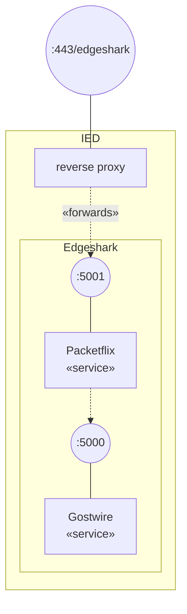

<!-- markdownlint-disable MD029 -->
# Getting Started

**Edgeshark** consists of
1. two containerized 🛎 services named
   [Ghostwire](https://github.com/siemens/ghostwire) and
   [Packetflix](https://github.com/siemens/packetflix),
2. and an _optional_ Wireshark ⚙️ [csharg external capture
   plugin](https://github.com/siemens/cshargextcap) for live remote capture of
   network traffic.

## Service Deployment

We provide multi-architecture Docker images for the `linux/amd64` and
`linux/arm64` architectures.

> [!ATTENTION] Make sure you have a Linux kernel of at least version 4.11
> installed, however we highly recommend at least kernel version 5.6 or later.

<!-- tabs:start -->

#### **Docker Compose v2**

First, ensure that you have the Docker compose plugin v2 installed: `docker
compose version` should display the compose plugin version, but not any error.
For Debian users we recommend installing `docker-ce` instead of `docker.io`
packages, as the `docker-ce` packages are updated on a regular basis.

Then copy and paste the following command into a terminal to deploy the
Edgeshark services:

```bash
wget -q --no-cache -O - \
  https://github.com/siemens/edgeshark/raw/main/deployments/wget/docker-compose-localhost.yaml \
  | DOCKER_DEFAULT_PLATFORM= docker compose -f - up
```

Finally, visit http://localhost:5001 and start looking around your container
host virtual networking.

> [!NOTE] Using `DOCKER_DEFAULT_PLATFORM=` ensures that our multi-arch images
> are correctly deployed and especially avoids problems with Apple's Rosetta not
> being able to work with read-only image deployments.

> [!WARNING] The following quick start deployments will **expose TCP port 5001**
> (or 5500) also to clients external to your host. Make sure to have proper
> network protection in place.

In case you need to expose service TCP port 5001 to external clients then copy,
paste, and execute this command instead:

```bash
wget -q --no-cache -O - \
  https://github.com/siemens/edgeshark/raw/main/deployments/wget/docker-compose.yaml \
  | DOCKER_DEFAULT_PLATFORM= docker compose -f - up
```

In case port 5001 is already in use, either deploy directly the following
alternative composer file, or download and edit it before deploying:

```bash
wget -q --no-cache -O - \
  https://github.com/siemens/edgeshark/raw/main/deployments/wget/docker-compose-5500.yaml \
  | DOCKER_DEFAULT_PLATFORM= docker compose -f - up
```

This exposed Edgeshark on host port 5500 instead.

#### **Docker Bash**

In case your particular system doesn't support Docker compose v2, we provide a
simple fallback using a plain `bash` script.

```bash
wget -q --no-cache -O - \
  https://github.com/siemens/edgeshark/raw/main/deployments/nocomposer/edgeshark.sh \
  | DOCKER_DEFAULT_PLATFORM= bash -s up
```

The bash script takes a single argument, either `up` or `down`.

Finally, visit http://localhost:5001 and start looking around your container
host virtual networking.

> [!WARNING] This quick start deployment will **expose TCP port 5001** also to
> clients external to your host. Make sure to have proper network protection in
> place.

#### **Industrial Edge**

1. Download the [latest Edgeshark app `.zip`
   file](https://github.com/siemens/edgeshark/releases/latest) from the releases
   section of this project, depending on your IED's architecture:
   - `amd64` (`x86-64`) IEDs: `edgeshark-<version>-amd64.app.zip`,
   - `arm64` IEDs: `edgeshark-<version>-arm64.app.zip`.

2. Unpack the contained `edgeshark-<version>-<arch>.app` file inside the `.zip`
   archive.

3. Import the Edgeshark app file `edgeshark-<version>-<arch>.app` into your IEM
   Industrial Edge Management system.

4. Go to the catalog of your IEM and deploy/install the Edgeshark app onto your IED
   Industrial Edge Device(s).

  > [!WARNING] The Edgeshark UI and services are exposed via your IED's reverse
  > proxy at `https://`_ied-address_`/edgeshark/` **without requiring an IED
  > login**. This is required in order to support initiating remote packet
  > captures from the user interface and from Wireshark. (There's nothing we
  > can do until the IED-OS starts supporting session hand-overs from a user
  > web browser to an external application.)

5. Click on or touch the Edgeshark app tile in the IED user interface, or
   navigate your browser directly to `https://`_ied-address_`/edgeshark/`. You
   should now see the "Edgeshark" user interface.

   > [!NOTE] Edgeshark doesn't expose port 5001 on IEDs anymore; please use the
   > IED's reverse proxy TLS port 443 instead.

<!-- tabs:end -->

Please see [Getting around](getting-around) for a tour of the user interface.

Deploying Edgeshark creates the two services named packetflix and gostwire. On
plain Docker host deployments, packetflix is exposed at HTTP **port 5001** on
the host. On Industrial Edge devices, packetflix is instead only reachable at
TLS **port 443** via the device's reverse proxy at `/edgeshark/`, as shown
below.



## Optional Capture Plugin

Please note that you only need to install the external capture plugin
"[cshargextcap](https://github.com/siemens/cshargextcap)" for Wireshark if you
intend to live capture container network traffic. Otherwise, you can completely
ignore this section.

<!-- tabs:start -->

#### **Windows 64bit**

We offer Windows 64 bit installers for both the `amd64` (`x86-64`) and `arm64`
(Windows on Arm) platforms.

1. Make sure that you have a sufficiently recent [Wireshark (64
   bit)](https://wireshark.org) installed. At least version 3.0.2 or later is
   required, as otherwise the plugin won't work correctly due to bugs in
   Wireshark. Wireshark 4.x is also supported.

2. [Download the latest Windows
   installer](https://github.com/siemens/cshargextcap/releases/latest)
   `cshargextcap_*_windows_amd64_setup.exe` (or `…_arm64_setup.exe` for Windows
   on Arm) from the releases page of the siemens/cshargextcap project.

3. Run the downloaded installer; it needs administrator rights and asks you to
   accept the license before installing. The installer automatically locates
   your Wireshark installation and also registers the `packetflix:` URL
   handler.

   For unattended installation, run it with `/S`, optionally with `/D=<Wireshark
   extcap folder>`.

4. In Edgeshark's web UI simply click on one of the Wireshark fin buttons to
   start a Wireshark capture session.

To uninstall, use Windows' "Apps & features".

#### **Linux 64bit**

We offer distribution-specific packages in `.apk`, `.deb`, and `.rpm` formats
for both `amd64` and `arm64` architectures.

1. install Wireshark from your distribution repositories and allow it to be used
   by non-root users.
2. [add your user to the wireshark group](https://askubuntu.com/a/461037) (ask
   Ubuntu):

   ```bash
   sudo gpasswd -a $USER wireshark
   ```

   This is necessary so that Wireshark can correctly execute `dumpcap` for your
   non-root user in order to use the external capture plugin.
3. log out of your session and then in again so that the new group assignment
   takes effect.
4. [Download the latest plugin package](https://github.com/siemens/cshargextcap/releases/latest) suitable for your distribution and CPU architecture.
5. install the downloaded plugin package.
6. _optionally:_ start Wireshark to verify that the plugin was correctly
   detected and queried: three new external capture targets should have been
   added ("Docker host capture" and "packetflix:// remote cluster and container
   host capture").

   
7. In Edgeshark's web UI simply click on one of the Wireshark fin buttons to
   start a Wireshark capture session.

#### **macOS 64bit**

We support both the `arm64` ("Apple Silicon") and `amd64` (Intel) architectures
on macOS.

1. install [Wireshark](https://www.wireshark.org/download.html) first.

2. run in Terminal:

   ```bash
   /bin/bash -c "$(curl -fsSL https://github.com/siemens/cshargextcap/releases/latest/download/macos-install-handler.sh)"
   ```

   This installs the latest release for your user, without admin rights:

   - the `cshargextcap` plugin into Wireshark's personal extcap folder
     `~/.local/lib/wireshark/extcap`,
   - the `packetflix:` URL handler into
     `~/Applications/packetflix-handler.app`.

   Run the same command again to upgrade. It also replaces older installations
   that put the plugin into `Wireshark.app` and the handler into
   `/Applications`. Restart Wireshark afterwards if it was running.

3. navigate to the Edgeshark web UI at `http://localhost:5001`.

4. click on a fin button to start a live packet capture using Wireshark.

To uninstall, delete `~/Applications/packetflix-handler.app` and
`~/.local/lib/wireshark/extcap/cshargextcap`.

<!-- tabs:end -->

Please see [Capturing](capture) for how to capture container network traffic
using Wireshark with Edgeshark.
